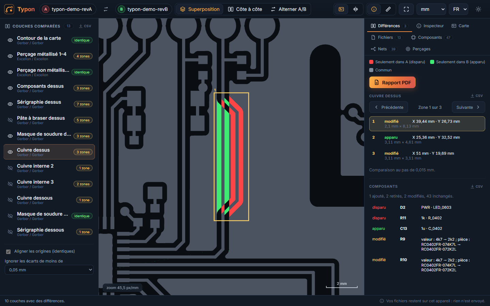
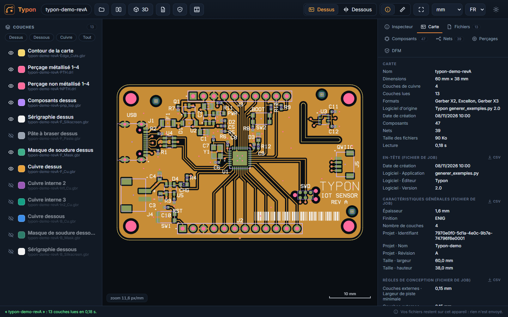
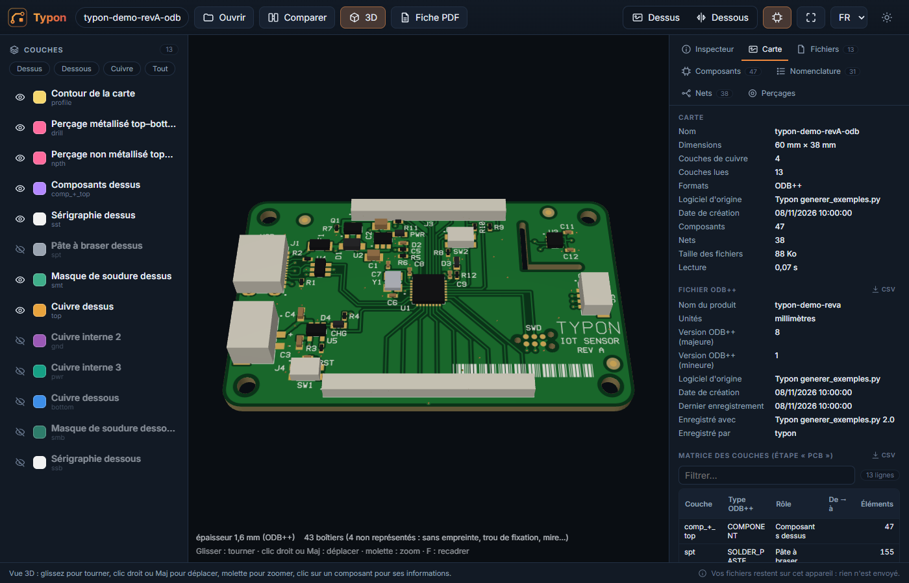
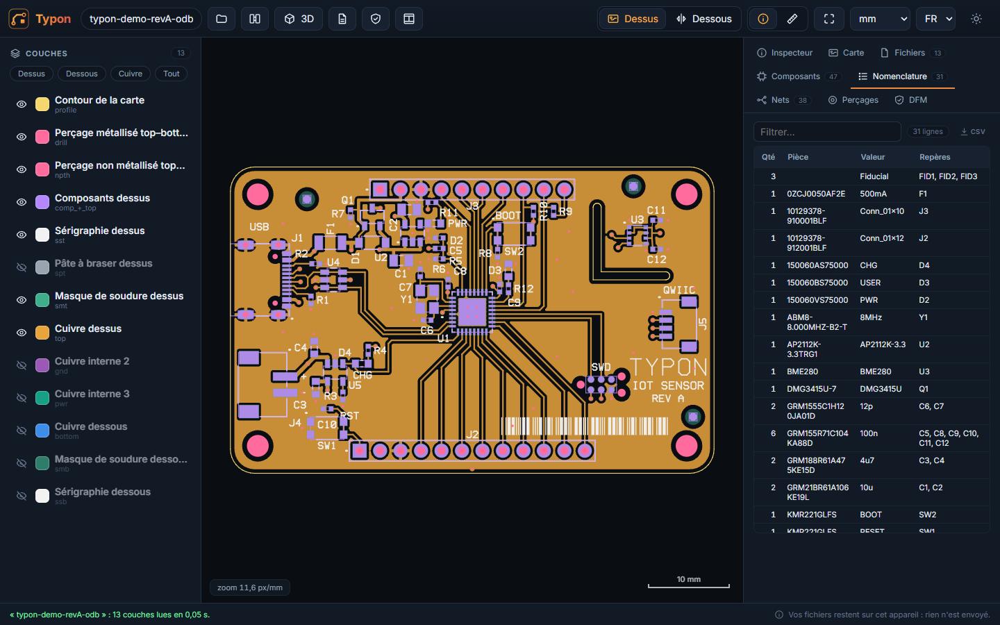
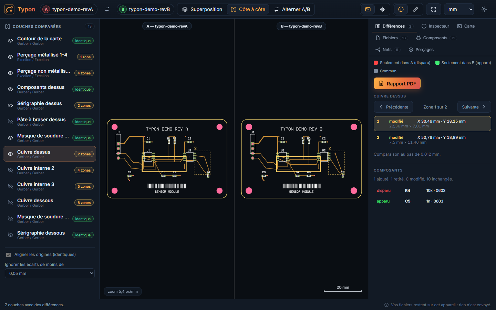

# Typon

**Visionneuse et comparateur de fichiers de fabrication de circuits imprimés**, dans le navigateur : Gerber
(RS-274X, X2, X3, et l'ancien RS-274D avec sa liste d'ouvertures), perçages Excellon et XNC, fichiers de job, ODB++,
IPC-2581. Pour les concepteurs électroniques qui veulent
vérifier ce qu'ils envoient au fabricant, et ce qui a changé d'une révision à l'autre.

**Ouvrir Typon : <https://yannickbuchet-ctrl.github.io/typon/>**



## Vos fichiers restent chez vous

Typon s'exécute **entièrement dans votre navigateur**. Le moteur de lecture, écrit en Rust et compilé en
WebAssembly, tourne sur votre ordinateur : aucun fichier n'est envoyé, aucun serveur ne les reçoit, aucune
statistique n'est collectée. La politique de sécurité du site interdit d'ailleurs toute connexion vers un autre site.
Une fois ouvert, Typon fonctionne aussi **hors ligne**, et peut s'installer comme une application (Chrome, Edge).

Rien à installer : un navigateur récent suffit (Chrome, Edge, Firefox, Safari), sur ordinateur, tablette ou téléphone.

L'interface est en **français et en anglais** (*English interface available*) : elle suit la langue du navigateur, et
le sélecteur FR/EN de la barre du haut permet d'en changer (le choix est mémorisé).

## Formats lus

| Format | Détails |
|---|---|
| **Gerber RS-274X** | Toutes les ouvertures standard et les macros (cercle, ligne, contour, polygone, thermique, moiré), parties non exposées des macros comme trous transparents, régions (G36/G37) avec arcs, arcs à quadrant unique et multiple, polarités claires et sombres (LP), miroir, rotation et échelle (LM, LR, LS), blocs d'ouverture imbriqués (AB), répétitions (SR), commandes anciennes (G54, G70/G71, IP, coordonnées incrémentales…) |
| **Gerber X2** | Attributs de fichier (fonction de la couche, logiciel, date, projet, polarité), d'ouverture (pastille CMS, via, conducteur…) et d'objet (net, composant, broche) |
| **Gerber X3** | Couches de composants : repère, valeur, boîtier, référence fabricant, rotation, côté |
| **Gerber RS-274D** | Avec son fichier d'ouvertures séparé, déposé avec lui : roue Eagle (`.whl`), liste Altium ou Protel (`.apr`), tableau de D-codes (cercle, carré, rectangle, oblong, octogone, anneau, thermique ; pouces, mils ou mm), ou commandes `%AD` dans un fichier à part. Le format des coordonnées, absent de ces fichiers, est déduit des coordonnées (une remarque le rappelle) |
| **Excellon et XNC** | Outils, trous, rainures (G85), fraisages (G00 à G03), répétitions, zéros omis, pouces ou mm, attributs X2 des perçages KiCad et XNC |
| **Fichier de job** (`.gbrjob`) | Taille, épaisseur, finition, empilage, règles de conception, rôle de chaque fichier |
| **Netlist IPC-D-356** | Liste des nets |
| **ODB++** 7 et 8 | Archive `.tgz`, `.zip` ou dossier ; matrice des couches, étapes et panneaux (step-repeat), pastilles, traits, arcs, surfaces, textes (police `standard`), codes-barres (code 39, ASCII étendu, clé de contrôle, fond inversé, texte), symboles standard (ronds, rectangles arrondis ou chanfreinés, ovales, beignets, thermiques, octogones…) et symboles utilisateur, composants et boîtiers, nets, outils de perçage, informations du fichier ; fichiers compressés `.Z` |
| **IPC-2581** révisions A, B et C | Fichier XML (`.xml`, `.cvg`) : couches et empilage, profil de la carte, traits, arcs, polylignes, contours avec découpes, pastilles par primitives standard (cercle, rectangles droits, arrondis ou chanfreinés, ovale, losange, ellipse, hexagone, octogone, triangle, beignet, thermique, papillon, moiré) ou utilisateur, piles de pastilles (KiCad) et `PadStack` (Altium), perçages et rainures, composants et boîtiers, nomenclature, nets, en-tête (logiciel, auteur, dates). Essayé sur les cas de test du consortium (Cadence Allegro), des exports KiCad 9 et 10 et un export Altium |
| **Archives** | ZIP, TAR, TGZ, y compris imbriquées ; un dossier entier peut être déposé |

Le rôle de chaque couche (cuivre dessus, interne, dessous, masque, sérigraphie, pâte, perçage, contour…) vient des
attributs X2, du fichier de job ou de la matrice ODB++, et sinon du nom du fichier (conventions KiCad, Altium,
Eagle, OrCAD, LibrePCB).

## Voir une carte



- **Couches** : afficher, masquer, changer la couleur et l'opacité ; préréglages Dessus, Dessous, Cuivre, Tout.
- **Vue de dessus et de dessous** (en miroir, comme on retourne la carte), touche **B**.
- **Inspecteur** : un clic sur une pastille, une piste, une zone, un perçage ou un composant donne son ouverture, sa
  fonction, son net, sa broche, son composant, sa position et son encombrement.
- **Mesure** (touche **M**) : distance et écarts en X et Y entre deux points, en mm, mil ou pouces.
- **Carte** : dimensions (sur l'axe du contour), couches, formats, logiciel d'origine, date, et tout le contenu du
  fichier de job ou des informations ODB++.
- **Fichiers** : pour chaque couche, son format, ses attributs X2, ses ouvertures (D-codes), ses outils de perçage,
  ses commentaires et les éventuelles remarques de lecture.
- Déplacement à la souris, au doigt ou au clavier (flèches), zoom à la molette ou au pincement, **F** pour cadrer la
  carte.
- **Export CSV** : chaque tableau (composants, nomenclature, nets, perçages, empilage, matrice des couches, fichiers,
  ouvertures, attributs X2, informations ODB++ ou IPC-2581, couches comparées, zones de différence, composants
  modifiés) a un petit bouton **CSV** à côté de son titre. Le fichier s'ouvre directement dans Excel en français
  (séparateur « ; », virgule décimale, UTF-8) et contient toutes les lignes, même celles que le filtre masque ou que
  l'affichage limite, dans l'ordre du tri choisi.

### Nets

Dans l'inspecteur (clic sur une piste ou une pastille), **Surligner ce net**, ou un clic sur une ligne de l'onglet
**Nets** : le net ressort en blanc sur toutes les couches visibles, les autres couches sont estompées, et l'onglet
**Net** donne la longueur de ses pistes par couche (sur l'axe des segments, sans les plans ni la traversée des vias),
ses pastilles, ses surfaces et ses trous. **Échap** efface le surlignage. Les nets viennent des attributs Gerber X2,
de l'ODB++ et de l'IPC-2581.

### Vérifications de fabricabilité (DFM)

Le bouton **DFM** ouvre l'onglet des règles : un profil de fabricant (JLCPCB, PCBWay, Eurocircuits classe 6,
OSH Park, ou « prudent ») règle les seuils, modifiables un par un. Chaque couche est aplatie en îlots (polarités
comprises), puis Typon vérifie :

- largeur des pistes, isolement entre îlots de cuivre de nets différents, **courts-circuits possibles** (un îlot qui
  porte deux nets : une vraie erreur, ou une liaison volontaire entre nets) ;
- anneau annulaire et pastille absente des trous métallisés sur les faces qu'ils atteignent (vias borgnes compris),
  perçage minimum, écart entre trous ;
- cuivre au bord de la carte et près des trous non métallisés ;
- ponts de vernis entre ouvertures ;
- sérigraphie : traits trop fins, sur une ouverture du vernis, hors de la carte.

Un clic sur une règle marque ses défauts sur la carte (cercle rouge, orange ou jaune selon la gravité), un clic sur un
défaut le centre. Le **rapport PDF** donne le bilan par règle, les vues de dessus et de dessous avec les marques, et la
liste des défauts. Les valeurs des profils sont indicatives : vérifiez les capacités exactes du fabricant.

### Mise en panneau

Le bouton **Panneau** répète la carte en lignes et en colonnes, avec des bords de manutention, des mires optiques, des
trous d'outillage et une séparation par **rainures en V** ou par **fraisage avec languettes perforées**. Le panneau est
écrit en Gerber X2 et Excellon dans une archive ZIP (quel que soit le format d'origine : un ODB++ ou un IPC-2581
devient ainsi des Gerber), téléchargeable, ou rouvert aussitôt dans Typon pour l'aperçu (vue 3D comprise).

Le contour du panneau est le bord de la matière réelle : cadre, cartes avec leurs découpes, et, en fraisage, les canaux
autour des cartes coupés par des languettes portant une rangée de perforations. Les perçages gardent leurs couches
(vias borgnes et enterrés) et leur métallisation par outil ; les fraisages sont écrits en chemins (G00, M15, G01,
M16). Les pastilles sont réécrites en régions, sans leurs attributs X2 : contrôlez le panneau avant commande.

### Fiche PDF de la carte

Le bouton **Fiche PDF** produit un document de description de la carte : vue 3D et caractéristiques (dimensions,
épaisseur, finition, couches, formats, logiciel d'origine, composants, nets, trous, plus petit perçage), vues de dessus
et de dessous, puis les tableaux de l'empilage, des couches, des perçages, des composants, de la nomenclature et des
nets, et les remarques de lecture. Il suit la langue de l'interface.

### Vue 3D

Le bouton **3D** (touche **V**) montre la carte en relief :




- plaque découpée selon le contour (découpes comprises), à l'épaisseur donnée par le fichier (ODB++, IPC-2581 ou
  fichier de job), sinon 1,6 mm ;
- faces habillées par le cuivre, le vernis épargne (vert, ouvert sur les pastilles dorées) et la sérigraphie, trous
  traversants métallisés ou non ;
- boîtiers des composants (ODB++, IPC-2581 et Gerber X3), à la taille de leur empreinte et à leur hauteur quand le
  fichier la donne (sinon estimée) ; un clic sur un boîtier affiche sa référence, sa valeur et ses dimensions ;
- rotation en glissant, déplacement au clic droit (ou Maj), zoom à la molette ou au pincement, vues de dessus et de
  dessous (la carte est retournée comme à la main).

### ODB++ mis en forme



Les données d'un fichier ODB++ ou IPC-2581 sont présentées en tableaux filtrables et triables : **matrice des couches** (type,
rôle, couches reliées par les perçages), **composants** (repère, valeur, boîtier, pièce, côté, rotation ; un clic
centre la vue sur le composant), **nomenclature** regroupée par pièce et valeur, **nets** avec leur nombre
d'éléments, **perçages** par outil (métallisé, non métallisé, via, diamètres de perçage et fini). Les pistes et
pastilles s'affichent avec le même moteur que les Gerber.

## Comparer deux versions



Ouvrez une première version, puis **Comparer** et la seconde version. Les deux peuvent être dans des formats
différents : un export Gerber et un export ODB++ de la même carte, par exemple.

- Les couches sont **appariées** automatiquement (même rôle, même côté, même numéro de couche).
- Trois affichages : **superposition** (rouge : seulement dans A, vert : seulement dans B, gris : commun),
  **côte à côte** (zoom et déplacement synchronisés) et **alternance** A/B (barre d'espace).
- Les **zones de différence** de chaque couche sont listées, avec leur position, leur taille et leur nature (apparu,
  disparu, modifié) ; **N** et **P** passent de l'une à l'autre.
- Les **composants** ajoutés, retirés ou modifiés (valeur, boîtier, pièce, position, rotation, côté) sont listés.
- **Alignement** automatique quand les origines diffèrent (carte de même taille placée ailleurs) et **tolérance**
  réglable pour ignorer les écarts d'approximation (arcs, export dans un autre format).
- **Rapport PDF** : synthèse par couche, vue d'ensemble de chaque couche modifiée avec ses zones numérotées, gros plans,
  liste des composants modifiés.

La comparaison est faite par rendu des deux couches sur une même grille (jusqu'à 4096 pixels de côté, soit 10 µm
par pixel pour une carte de 40 mm, 0,07 mm pour une carte de 300 mm).

## Pour essayer

L'accueil propose une **carte d'exemple** fictive (en Gerber X2/X3 et en ODB++) : un nœud capteur IoT de 60 × 38 mm à
4 couches, avec 47 composants (microcontrôleur en QFN-32, USB-C, chargeur de batterie, capteur isolé par une découpe,
connecteur Qwiic, barrettes), plans de masse et d'alimentation, vias, sérigraphie et composants en 3D. La
comparaison de ses **révisions A et B** montre une piste SCL déroutée, deux résistances changées de valeur, une LED
et sa résistance retirées, un condensateur ajouté et un via déplacé.

La carte respecte les règles de fabrication courantes, sauf **six défauts volontaires**, cachés mais détectables
(piste de 0,10 mm, isolement de 0,09 mm, anneau de 0,05 mm, via à 0,25 mm du bord, perçage de 0,25 mm, texte de
sérigraphie sur une pastille) : ils sont décrits, avec leur position, dans [docs/defauts-exemple.md](docs/defauts-exemple.md).
Ces fichiers sont générés par `scripts/generer_exemples.py`.

## Raccourcis

| Touche | Action |
|---|---|
| F | Cadrer la carte |
| B | Retourner la carte (dessus / dessous) |
| M | Mesurer |
| V | Vue 3D ou vue 2D |
| Échap | Effacer la sélection et la mesure |
| + et − | Zoom |
| Flèches | Déplacer la vue |
| 1, 2, 3 | Comparaison : superposition, côte à côte, alternance |
| Espace | Comparaison en alternance : passer de A à B |
| N et P | Zone de différence suivante ou précédente |

## Limites connues

- **RS-274D** : sans sa liste d'ouvertures, les tracés sont dessinés en trait fin, avec un avertissement. Avec elle, le
  format des coordonnées est deviné (2.4 ou 2.3 pouces, 3.3 mm…) : vérifiez les dimensions de la carte.
- **IPC-2581** : les textes décrits par une police (élément `Text`) ne sont pas dessinés (les logiciels les écrivent
  le plus souvent en traits) ; les fichiers de révision A de Zuken CR5000 (`LayerDesc`, `StepList`) ne sont pas lus.
- **ODB++** : seule l'étape de la carte est affichée quand le produit contient aussi un panneau.
- Les arcs sont approchés par des segments à 1 µm près.

## Développement

Il faut [Rust](https://rustup.rs/) avec la cible WebAssembly (`rustup target add wasm32-unknown-unknown`) et
[Node.js](https://nodejs.org/) 22 ou plus récent.

```
npm install
npm run dev          # site de développement (compile aussi le moteur Rust)
npm run build        # moteur WebAssembly, vérification TypeScript, site dans dist/
```

Structure :

- `core/` — moteur Rust : `gerber.rs`, `ouvertures.rs` (listes d'ouvertures du RS-274D), `excellon.rs`, `job.rs`,
  `odb.rs`, `ipc2581.rs`, `archive.rs` (ZIP, TAR, gzip, LZW),
  `couches.rs` (rôle des couches), `geom.rs` (primitives, triangulation, opérations booléennes, index spatial),
  `zones.rs` (zones de différence), `lib.rs` (interface WebAssembly, sans wasm-bindgen).
- `src/moteur/` — Web Worker qui charge le moteur, et son client ; `src/rendu/` — affichage WebGL2 ; `src/ui/` —
  interface.

Essais :

```
python scripts/generer_exemples.py        # cartes d'exemple du site (public/exemples/), avec shapely
python scripts/verifier_exemple.py        # vérification indépendante des cartes d'exemple (shapely, pillow)
node scripts/telecharger-exemples.mjs     # fichiers publics de test (Ucamco, ODB++), hors du dépôt
cd core && cargo test --release -- --nocapture
node scripts/essai-navigateur.mjs         # après npm run build : parcours complet dans Chromium
node scripts/essai-fabrication.mjs        # après npm run build : nets, DFM et rapport, panneau
node scripts/essai-fiche.mjs              # après npm run build : fiche PDF de plusieurs cartes
node scripts/essai-3d.mjs                 # après npm run build : vue 3D (exemples, et exemples externes s'il y en a)
node scripts/essai-csv.mjs                # après npm run build : export CSV de chaque tableau
```

Les essais dans le navigateur prennent leur port dans la variable `PORT_ESSAI` (de 4191 à 4197 par défaut).

Les essais du moteur comparent le rendu des fichiers de test de la norme Gerber (Ucamco) à leurs images de
référence, lisent tous les jeux d'exemple (cartes KiCad et LibrePCB en X2/X3, XNC, fichiers de job, ODB++ officiel
et exports KiCad, IPC-2581 du consortium, de KiCad et d'Altium), vérifient que la carte d'exemple en RS-274D (roue
Eagle, liste Protel) donne les mêmes pistes et pastilles que sa version X2, et que le code-barres ODB++ correspond à celui que le
générateur calcule de son côté. Le parcours dans le navigateur vérifie l'affichage, l'inspecteur, l'ODB++, la comparaison (dont
Gerber contre ODB++ de la même carte, qui doit donner des couches identiques) et le rapport PDF.

`.github/workflows/pages.yml` teste, construit et publie le site sur GitHub Pages ; il ne se lance qu'à la main.

## Crédits

- Logiciel écrit par **Claude Code** (Claude Opus 5.5) sous la direction de **Yannick Buchet**.
- Composants tiers : voir [LICENCES-TIERCES.md](LICENCES-TIERCES.md).
- Normes : *The Gerber Layer Format Specification* et *Gerber Job Format* (Ucamco), *XNC Format* (Ucamco),
  *ODB++ Format Specification* (Siemens), IPC-2581 (consortium IPC-2581).

Licence MIT.
